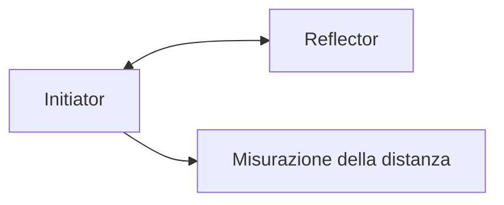
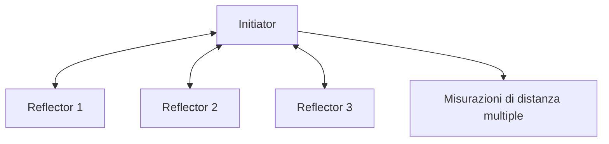
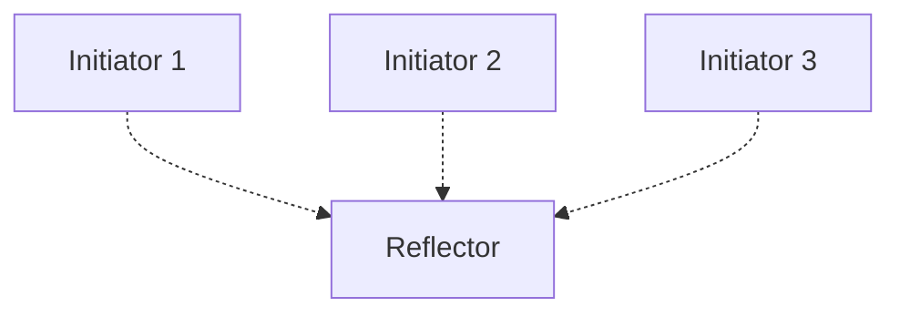

# nordic54L15dk-firmware

# Firmware Repository – Asset Tracking e Stima della Distanza

## Struttura della repository

La repository è organizzata in tre cartelle, ognuna delle quali corrisponde a uno scenario di comunicazione tra schede **Initiator** e **Reflector**.

I tre scenari differiscono per il numero di dispositivi coinvolti e per le modifiche apportate ai rispettivi firmware.

```text
.
├── one-initiator_one-reflector/
│   └── Firmware per un Initiator e un Reflector
│
├── one-initiator_multi-reflector/
│   └── Firmware per un Initiator e più Reflector
│
└── one-reflector_multi-initiator/
    └── Firmware per un Reflector e più Initiator
```

## 1. `one-initiator_one-reflector`

Questo scenario permette la comunicazione tra **un solo Initiator e un solo Reflector**.

L'obiettivo è misurare la distanza tra le due schede, acquisendo le misurazioni generate durante la comunicazione.

### Caratteristiche

- Un Initiator comunica con un Reflector.
- È possibile acquisire misurazioni di distanza tra le due schede.
- Non è possibile effettuare asset tracking con stima della posizione, poiché lo scenario prevede un solo Reflector e quindi non dispone di più riferimenti di distanza per localizzare il dispositivo.

### Schema di comunicazione



## 2. `one-initiator_multi-reflector`

Questo scenario permette la comunicazione tra **un solo Initiator e più Reflector contemporaneamente**.

È lo scenario utilizzato in laboratorio per eseguire test di **stima della posizione utilizzando più schede**.

### Caratteristiche

- Un Initiator comunica con più Reflector.
- È possibile raccogliere misurazioni di distanza rispetto a più schede.
- Le misurazioni possono essere utilizzate come input per algoritmi di stima della posizione e asset tracking.

### Modifiche al firmware

La modifica principale riguarda il firmware dell'**Initiator**, che è stato adattato per gestire la comunicazione con più Reflector.

Il firmware del **Reflector** rimane invece uguale a quello utilizzato nello scenario `one-initiator_one-reflector`.

### Schema di comunicazione



## 3. `one-reflector_multi-initiator`

Questo scenario tenta di realizzare una configurazione in cui **un solo Reflector comunica con più Initiator contemporaneamente**.

Per implementare questa configurazione, è stato modificato il firmware del Reflector, con l'obiettivo di consentirgli di gestire le richieste provenienti da più Initiator.

### Caratteristiche

- Più Initiator tentano di comunicare con un unico Reflector.
- Il firmware del Reflector è stato modificato per supportare questa configurazione.


Questo scenario è stato abbandonato inizialmente per motivi pratici: questa configurazione infatti prevede la connessione di ogni initiator ad un PC per salvare i dati da poter utilizzare in un secondo momento per fare stime di posizione.
La documentazione e le discussioni sulla Nordic DevZone segnalano limitazioni nel supporto di questa configurazione. Di conseguenza, lo sviluppo di questo scenario non è stato portato avanti in quanto inutilizzabile per i test di stima della posizione.

### Schema della configurazione tentata



## Riepilogo degli scenari

| Scenario | Configurazione | Firmware modificato | Stato / Utilizzo |
|---|---|---|---|
| `one-initiator_one-reflector` | 1 Initiator, 1 Reflector | Firmware di base | Misurazione della distanza |
| `one-initiator_multi-reflector` | 1 Initiator, più Reflector | Initiator | Utilizzato nei test di laboratorio per la stima della posizione |
| `one-reflector_multi-initiator` | Più Initiator, 1 Reflector | Reflector | Versione non utilizzabile |

